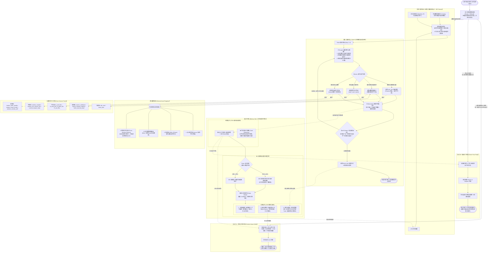
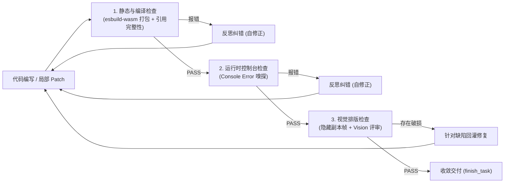
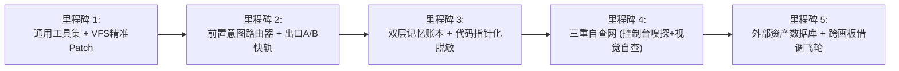

# OpenPencil Mock 认知型 Agent 架构方案设计规范（实施蓝图）

> 本规范确立了 OpenPencil 中「Mock 设计」AI 功能的下一代架构设计，彻底告别单一大循环与死板流水线，重构为基于 **ReAct 循环推理自查、双层长短期记忆中枢、外部资产数据库与五大通用原子工具箱** 的认知智能体系统。

---

## 一、 系统总体架构与设计哲学

### 1.1 核心设计哲学
1. **告别单向死板流水线**：以 **ReAct（Thought ➔ Decision ➔ Action ➔ Observation ➔ Self-Critique）** 为核心认知内核，模型自主按需决策动作，达标即停，发现问题自纠。
2. **绝不全量随身揣着**：请求头仅注入极简状态与能力目录清单（$\approx 300\text{ Tokens}$）；记忆按需索引，工具按意图激活，外部知识按接口调取。
3. **精准提前出口（Early Exits）**：90% 的高频日常操作（问答复盘、单点改字换色）走独立快轨，数秒内交付，绝不盲目拉起重型大循环。
4. **全生命周期三重自查**：构筑“静态编译（esbuild）”到“运行时控制台（Console Error）”再到“视觉排版（Vision Model）”的三重防线。

### 1.2 全景架构流转图



---

## 二、 分流中枢：前置意图路由器与三轨出口

### 2.1 路由器规格与判定契约
- **运行特征**：由最轻量模型（或主模型 `maxTokens: 50, temperature: 0`）运行，目标响应耗时 $\le 500\text{ms}$。
- **判定 Schema**：
```ts
export interface RouterVerdict {
  track: 'consult' | 'patch' | 'workflow'
  confidence: number // 0~1
  targetFile?: string // 仅 patch 轨需要，若无法确定则降级为 workflow
  reason: string
}
```

### 2.2 三轨出口行为准则

#### 轨道 1：项目感知型咨询轨（出口 A）
- **触发条件**：用户进行概念咨询、代码解释、方案复盘、闲聊追问（如：“说说为什么这么设计？”、“刚才为什么选了 ts-static 架构？”）。
- **执行协议**：
  1. 挂载 LTM 决策账本中的 `architectural_decisions`；
  2. 挂载 STM 最近 2 轮对话与当前工程文件树（VFS Tree）；
  3. **0 写工具**（禁止触发任何代码修改）；
  4. 单次流式输出专业答案后**立即退出**。

#### 轨道 2：局部补丁快轨（出口 B）
- **触发条件**：单文件局部的文案微调、单点 CSS 属性变更（如：“把副标题改成‘即刻体验’”、“主按钮背景换成 #2563eb”）。
- **执行协议**：
  1. 仅加载目标文件的当前内容；
  2. LLM 单轮直接输出精确的 `Search & Replace` 补丁块；
  3. 内存直接 Patch 虚拟文件，防抖调用 `esbuild-wasm` 编译并刷新 iframe；
  4. 3 秒内交付退出。
- **★ 自动平滑升轨机制（Auto-Escalation）**：若模型在 Patch 过程中判定改动破坏了模块接口或需跨多文件联动，系统**不报错、不中断**，直接将上下文无缝移交至第二循环继续执行。

#### 轨道 3：深度认知慢轨（进入第二循环）
- **触发条件**：从零生成页面、全模块重构、多组件联动开发、复杂动效集成。

---

## 三、 轻量请求头与按需上下文组装

进入第二循环后，系统**绝对禁止将完整工具 Schema 和冗长历史倾倒给模型**，而是严格装配标准轻量请求头（$\approx 300\text{ Tokens}$）：

```markdown
# SYSTEM HEADER (OpenPencil Cognitive Core)

## 1. 长期状态与画像 (LTM Summary)
- 用户偏好: 极简现代暗黑风; 圆角统一 8px; 必须支持中文.
- 严令雷点: 严禁内联 style 标签; 严禁使用 Lorem Ipsum 占位; 严禁超大第三方库.
- 架构决策: ts-static (index.html -> scripts/main.ts); 主题色 #3b82f6.
- 任务进度: [已完成] 骨架搭建; [进行中] 登录表单交互; [待办] 错误提示动效.

## 2. 可用能力清单 (Tool Manifest - 按需激活)
- code: 虚拟文件读写与局部精准 Patch 补丁.
- env: esbuild 内存编译、控制台日志与视口调整.
- inspection: 静态确定性检查、控制台嗅探与视觉快照多模态评审.
- search: 代码全文检索与外部资产库检索.
- coordination: 需求澄清挂起 (ask_user) 与最终交付 (finish_task).

## 3. 外部资产货架索引 (External Registry Catalog)
- norms: [mobile-h5, desktop-web, bento-grid]
- skills: [echarts-charts, css-spring-animation, mock-fetch]
- cross_window_artifacts: 本画板已索引历史优质页面与组件 (支持跨窗口借调)
```

---

## 四、 双层记忆中枢与无感自适应压缩引擎

### 4.1 长期记忆（LTM）结构化账本模型
长期记忆严禁采用模糊自然语言，必须为严格可合并的结构化状态表（State Ledger）：

```ts
export interface LongTermMemoryLedger {
  // 1. 人物画像层 (持久化在全局用户配置中，跨工程共享)
  persona_and_constraints: {
    aesthetic: string
    forbidden_redlines: string[]
    strict_requirements: string[]
    user_habits: string[]
  }
  // 2. 架构决策层 (持久化在当前画板 Page 节点的 pluginData 内部)
  project_architecture: {
    project_kind: 'html' | 'ts-static' | 'spa'
    entry_point: string
    design_tokens: Record<string, string>
    file_responsibilities: Record<string, string>
    decision_log: string[] // 选型与技术抉择理由
  }
  // 3. 任务履历层 (持久化在当前画板 Page 节点内部)
  session_progress_ledger: {
    completed_milestones: string[]
    in_progress: string
    pending_todo: string[]
    unresolved_debts: string[]
  }
}
```

### 4.2 短期记忆（STM）与代码指针化脱敏机制（Code Offloading）
- **核心痛点解决**：前端 Agent 一次写入数千行代码会瞬间击穿上下文窗口。
- **解耦机制**：
  1. 真实源码只存放在宿主内存的虚拟文件系统（VFS）中；
  2. 短期记忆历史记录中的 `write_project_file` 返回值统一脱敏为**轻量不可变指针**：
     ```json
     {
       "file_ref": "styles/main.css",
       "lines": 142,
       "hash": "a8f9c2",
       "exports": [".btn-primary", ".card-bento"]
     }
     ```
  3. 模型若需查阅，通过通用工具 `fs_read_file({ path, lineStart, lineEnd })` 按需精确拉取局部切片。

### 4.3 双水位线无感压缩调度体系
- **同步模型窗口**：根据接入模型（如 Claude 200k / DeepSeek 64k / 本地模型 16k）动态计算 Token 水位。
- **双水位线策略**：
  - **80% 软水位线（Soft Watermark）**：
    - 在用户阅读回复、页面热重载渲染等交互空隙，**启动后台异步 Web Worker / 静默 LLM 任务**；
    - 执行信息蒸馏，更新 LTM 结构体字段；
    - 消除滑动窗口尾部的过期细枝末节，主会话无卡顿、零感知。
  - **95% 硬水位线（Hard Watermark）**：
    - 强制同步熔断，直接剔除中间过程文本与推理链，仅保留 LTM 核心请求头和最新 2 轮上下文，防止接口抛出 `Context Window Exceeded` 异常。
- **防“传话筒”失真**：每次蒸馏直接更新 LTM 键值表（Merge & Overwrite），严禁使用“对摘要再做摘要”。

---

## 五、 ReAct 认知推理与三重自查闭环内核

在第二循环中，Agent 按照标准 ReAct 范式步进，并在收敛前经过严格的**三重自查网**：



### 5.1 三重自查防线落地细节

1. **第一重：静态与编译自查（Deterministic Static Check）**
   - 依赖 `compiler.ts` 的 `esbuild-wasm` 虚拟文件系统插件；
   - 检查 TS/TSX 语法树、模块相对引用有效性、CSS 花括号对称性；
   - 发现错误立即终止后续渲染，将编译器错误直接喂回给 Agent 自纠。
2. **第二重：运行时控制台错误嗅探（Console Error Sniffer）**
   - 在预览 iframe 内部注入轻量监控垫片：
     ```html
     <script>
       window.addEventListener('error', e => parent.postMessage({ type: '__mockConsoleErr', msg: e.message, line: e.lineno }, '*'));
       window.addEventListener('unhandledrejection', e => parent.postMessage({ type: '__mockConsoleErr', msg: String(e.reason) }, '*'));
     </script>
     ```
   - 捕获未声明变量、空指针属性访问或异步崩溃，拦截静态好看但实际逻辑瘫痪的“花架子”。
3. **第三重：视觉排版自查（Vision Aesthetic Review）**
   - 通过 `sandbox="allow-same-origin"` 隐藏副本帧（无脚本污染，排查纯 CSS 渲染）；
   - 使用 `html2canvas-pro` 截取视口 PNG；
   - 驱动 Vision 模型排查：文字截断、元素重叠、对比度不足、布局崩塌；
   - 配合问题签名比对（Signature Stagnation Check），连续两轮问题相同即停滞熔断，杜绝死循环。

---

## 六、 外部资产数据库与自产自销飞轮

### 6.1 外部资产四维矩阵

| 资产类型 | 资产内容 | 获取方式 |
|---|---|---|
| **Norms（设计规范）** | 平台字阶、色板、网格基线、无障碍间距 | `fetch_external_asset({ type: 'norms', id })` |
| **Skills（技能包）** | 复杂图表（ECharts）、Canvas粒子、复杂拖拽手势代码模板 | `fetch_external_asset({ type: 'skills', id })` |
| **Mock Presets（数据模板）** | 电商SKU、SaaS流水、用户权限树高保真真实假数据 | `fetch_external_asset({ type: 'mock_presets', id })` |
| **Cross-Window Artifacts（跨窗口作品）** | 同画布其他 Page 节点历史沉淀的高质量组件或页面 | `search_external_registry({ type: 'artifacts', query })` |

### 6.2 渐进式检索协议
- **L0 索引广播**：请求头中仅声明类别与高频 ID 列表（$\approx 50\text{ Tokens}$）；
- **L1 目录检索**：模型调用 `search_external_registry` 获得轻量元数据卡片（标题、摘要、评分）；
- **L2 靶向装载**：模型调用 `fetch_external_asset` 单点拉取特定代码片段，临时挂入当轮短期记忆。

### 6.3 跨画板借调防护与“自产自销”飞轮（Promotion Hook）
- **数据脱敏**：跨画板抓取历史组件时，**自动剔除 Base64 大图片与超大内联数组**，仅提取 DOM 骨架与 CSS 样式规范（单个资产尺寸限制在 1500 Tokens 以内）。
- **资产升格飞轮（Asset Promotion）**：
  - 当某个 Mock 页面顺利通过三重自查、用户点击“完成/保存”后；
  - 触发后台切片任务，提取其布局网格、配色风格、高保真组件，打上语义标签写入本地外部数据库；
  - 形成“越画资产越多、越用越聪明”的生态复用正循环。

---

## 七、 通用五大支柱原子工具箱规范

全系统收敛为 **12 个通用核心工具**，通过 `@ai-sdk/valibot` 规范化定义：

```ts
export const CORE_AGENT_TOOLS = {
  // 1. 代码能力组 (Code Operations)
  fs_read_file: tool({
    description: '读取虚拟文件内容，支持分段行号读取以节约上下文',
    parameters: v.object({
      path: v.string(),
      lineStart: v.optional(v.number()),
      lineEnd: v.optional(v.number())
    })
  }),
  fs_write_file: tool({
    description: '全量写入新建或重写虚拟文件',
    parameters: v.object({
      path: v.string(),
      content: v.string()
    })
  }),
  fs_patch_file: tool({
    description: '对虚拟文件执行精确代码块替换，单点小修首选（极省Token）',
    parameters: v.object({
      path: v.string(),
      search: v.string(),
      replace: v.string(),
      expectedVersion: v.optional(v.number()) // 乐观锁
    })
  }),
  fs_list_files: tool({
    description: '列出当前虚拟文件系统目录树与文件大小摘要',
    parameters: v.object({})
  }),

  // 2. 环境与运行时组 (Runtime Operations)
  runtime_compile: tool({
    description: '触发内存 esbuild 打包，返回编译错误与警告',
    parameters: v.object({ entry: v.optional(v.string()) })
  }),
  runtime_set_canvas_size: tool({
    description: '动态设置画布与预览视口物理分辨率',
    parameters: v.object({ width: v.number(), height: v.number() })
  }),
  runtime_inspect_state: tool({
    description: '获取当前运行时技术形态、环境变量与依赖清单',
    parameters: v.object({})
  }),

  // 3. 审查组 (Inspection Operations)
  inspect_static_quality: tool({
    description: '检查相对引用链接完整性、CSS花括号配平与雷点守卫',
    parameters: v.object({})
  }),
  inspect_visual_render: tool({
    description: '主动触发后台无脚本副本帧渲染并执行多模态排版自查',
    parameters: v.object({})
  }),

  // 4. 搜索与外部库组 (Search & Registry Operations)
  search_codebase: tool({
    description: '在当前项目代码库中全文正则检索关键词',
    parameters: v.object({ query: v.string() })
  }),
  search_external_registry: tool({
    description: '检索外部数据库（设计规范/技能包/假数据/跨窗口历史作品）',
    parameters: v.object({
      type: v.picklist(['norms', 'skills', 'mock_presets', 'artifacts']),
      query: v.string()
    })
  }),
  fetch_external_asset: tool({
    description: '根据ID精确拉取外部资产详情至当前工作区',
    parameters: v.object({ type: v.string(), id: v.string() })
  }),

  // 5. 协调组 (Coordination Operations)
  ask_user: tool({
    description: '需求存在分歧时发起交互式提问（返回 Promise 挂起当前步）',
    parameters: v.object({
      questions: v.array(v.object({
        question: v.string(),
        options: v.optional(v.array(v.string()))
      }))
    })
  }),
  finish_task: tool({
    description: '三重自查全部达标后宣布任务完成并输出成果总结',
    parameters: v.object({ summary: v.string() })
  })
}
```

---

## 八、 系统边界防线：安全、并发与容错熔断

### 8.1 沙箱与网络安全防线
1. **iframe 双向隔离约束**：
   - 预览 iframe 统一设置：`sandbox="allow-scripts allow-forms allow-popups"`；
   - **严禁配置 `allow-same-origin`**，杜绝生成的未知代码穿透至 Tauri 宿主获取本地权限。
2. **CSP 外部域白名单**：仅允许加载 `esm.sh`、`unpkg.com`、`cdnjs.cloudflare.com` 等受信任 CDN，禁止任意不明域名外链。
3. **虚拟路径穿越清洗**：统一使用 `normalizeProjectPath()` 剔除盘符与 `..` 相对路径，杜绝宿主磁盘遍历。

### 8.2 并发与人机共驾防线（乐观锁与快照回滚）
1. **VFS 版本号乐观锁**：虚拟文件带有自增 `version`。模型调用 `fs_patch_file` 时若 `expectedVersion` 不匹配，说明用户在编辑器中发生了手动编辑，工具拦截并提示模型重新拉取最新代码，防止冲掉用户手写内容。
2. **事务快照（Transaction Snapshot）**：进入深度 ReAct 循环前，自动给 VFS 拍快照。用户点击取消生成时，提供“保留半成品”或“一键复原至干净状态”的明确选项。

### 8.3 动作指纹与死循环熔断器（Circuit Breaker）
- **死循环指纹拦截**：记录最近 3 次工具调用的错误输出签名。若检测到连续 3 次报错内容完全一致，系统直接拦截工具执行并强制注入：“已在相同错误上陷入停滞，请停止当前尝试，转向重构或报错回退逻辑”。
- **硬步数上限**：深度 ReAct 单次最大轮次限制为 25 步，到顶自动强行收敛落地。

---

## 九、 工程落地实施路径与目录拓扑

### 9.1 源码目录结构规划
在 `src/app/mock/` 下完成新模块的清晰解耦：

```text
src/app/mock/
├── router/                    # 模块一：前置意图路由器
│   ├── index.ts               # 分流器核心
│   └── prompts.ts             # 极轻量路由判定 Prompt
├── memory/                    # 模块二：双层记忆与压缩引擎
│   ├── ltm.ts                 # 长期记忆结构体与状态覆写算法
│   ├── stm.ts                 # 短期滑动窗口与代码指针化
│   └── compression.ts         # 80%/95% 双水位线静默蒸馏器
├── tools/                     # 模块三：通用原子工具集
│   ├── code.ts                # fs_read / write / patch / list
│   ├── env.ts                 # compile / set_size / inspect
│   ├── review.ts              # static_quality / visual_render
│   ├── search.ts              # grep / search_registry / fetch
│   ├── coordination.ts        # ask_user / finish_task
│   └── registry.ts            # 工具统一导出工厂
├── registry/                  # 模块四：外部资产数据库
│   ├── norms/                 # 本地设计规范
│   ├── skills/                # 技能包与图表模板
│   ├── mock-data/             # 业务假数据预设
│   └── artifacts.ts           # 跨画板作品索引与切片升格飞轮
├── engine/                    # 模块五：ReAct 认知自查引擎
│   ├── agent.ts               # ReAct 循环主驱动
│   └── console-sniffer.ts     # 运行时控制台错误嗅探
└── index.ts                   # 统一导出供 UI 面板调用
```

### 9.2 逐步实施里程碑（Milestones）



1. **里程碑 1（基础原子底座）**：落地 `tools/code.ts` 中的 `fs_patch_file` 与 VFS 乐观锁，替换原来全量写大文件的低效机制；
2. **里程碑 2（极速提前出口）**：实现 `router/` 前置分类器，调通出口 A（关联记忆只读咨询）和出口 B（局部单点 Patch），彻底斩断“改小需求也跑大循环”的痛点；
3. **里程碑 3（记忆与无感压缩）**：实现代码指针化脱敏（Code Offloading）与 80%/95% 软硬双水位线后台蒸馏；
4. **里程碑 4（自查闭环升级）**：在预览中挂载控制台日志嗅探器，串联编译、运行时与 Vision 三重自查防线；
5. **里程碑 5（生态资产打通）**：落地跨画板作品库索引、规范包与自产自销升格飞轮。
